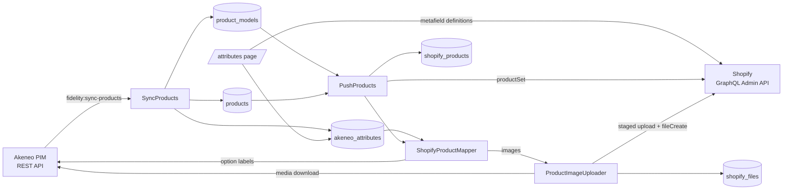

# Architecture

Akeneo is the source of truth, and the local tables mirror it. Shopify is only written to by `fidelity:push-products`.

## Sync pipeline: `fidelity:sync-products`

`app/Console/Commands/SyncProducts.php`

1. Pages through `/api/rest/v1/attributes` (with the options of select attributes), then `/api/rest/v1/product-models` and `/api/rest/v1/products`, with 100 items per page. Products and product models use `search_after` pagination; attributes and options only support page offsets.
2. For **root** product models (no `parent`), it resolves the family-variant axes, for example `[color, size]`, and stores them in `variant_axes`.
3. Upserts rows in batches of 100: `akeneo_attributes` and `product_models` by `code`, and `products` by `identifier`. For attributes, only the Akeneo columns are written, so the Shopify choices made in the interface are kept. JSON columns are encoded by hand, because `upsert()` bypasses model casts.
4. Every row of a run gets the same `synced_at` (truncated to the second). Rows with an older `synced_at` are no longer in Akeneo: the command warns about them, and deletes them with `--prune`. Nothing is pruned if the sync fails, and a table is not pruned when Akeneo returned none of its rows (usually a configuration or permission problem).

It runs **hourly** with `withoutOverlapping()` (`routes/console.php`).

## Push pipeline: `fidelity:push-products`

`app/Console/Commands/PushProducts.php`

1. `ensureAkeneoCodeDefinition()` makes sure the `akeneo.code` product metafield definition exists. It must be type `id` with unique values, because it's the custom ID used for upserts.
2. Groups products by their **root product model**, walking up through sub-models. A product without a parent is its own group.
3. `ShopifyProductMapper` builds a `ProductSetInput` for each group (see [Shopify mapping](shopify-mapping.md)). Images not yet in Shopify are downloaded from Akeneo and uploaded by `ProductImageUploader` at this step.
4. The input is hashed. Groups whose hash matches the last successful push are skipped, unless `--force` is set.
5. `productSet` is called with `identifier: { customId: akeneo.code }`, which creates or updates the product. The Shopify ID, the hash, `pushed_at`, or `last_error` is stored in `shopify_products`.
6. Prints a Created / Updated / Skipped / Failed summary. The command fails if any product failed.

The push is not scheduled yet.

## Run history: `sync_runs`

Both commands use the `App\Console\Concerns\RecordsSyncRun` trait, so every run is recorded, whether it comes from the CLI, the scheduler or the web interface:

1. At start, the trait takes the command's **lock** (`SyncRun::LOCKS`, an atomic cache lock on the `database` store) and holds it until the run ends, releasing it in a `finally`:
   - `fidelity:akeneo-writes` for `fidelity:sync-products`, also taken by the **Update from Akeneo** button on `/attributes`, because both write the Akeneo tables. Two writers with different `synced_at` values could otherwise make `--prune` delete rows the other one just wrote. The button holds it with the same lifetime. TTL 4 h.
   - `fidelity:shopify-push` for `fidelity:push-products`. TTL 4 h.

   Both TTLs are above the job's 1 h timeout and leave room for CLI and scheduled runs, which have no timeout.

   If the lock is held, the run doesn't start: it prints `Not started: …`, exits with a failure, and closes its `queued` row (from the interface) with that message. A refused CLI or scheduler run records no row. Sync and push have separate locks, so a push can run during a sync.
2. With the lock held, the trait creates a `sync_runs` row with status `running` and the lock's owner token (`lock_owner`). A run started from the interface instead claims its `queued` row, passed with the internal `--sync-run=` option. Any older `running` row of the same command is marked `failed` ("Interrupted before it finished"): since this run holds the lock, that process must have died.
3. If the queue worker kills the job (timeout, crash), `RunSyncCommand::failed()` releases the run's lock with its owner token, so the next run doesn't wait for the TTL. A process killed outside the queue leaves its lock until the TTL expires.
4. Every `info`/`warn`/`error` line is printed as usual and also appended to `storage/app/private/sync-runs/{id}.log`, as `[Y-m-d H:i:s] LEVEL message`. The `local` disk is private, so logs are only served through the authenticated download route.
5. At the end, the trait stores `succeeded` or `failed` (from the exit code), `counts`, `finished_at` and the abort message. An unexpected exception is recorded as `failed` with its message, then rethrown.

## Web interface

Blade + Tailwind pages behind a login (`App\Http\Controllers\Auth\LoginController`, rate-limited to 5 attempts per minute per email and IP). There is no public registration: users are created with `fidelity:create-user`.

Every response goes through `App\Http\Middleware\SecurityHeaders` (registered globally in `bootstrap/app.php`): a Content Security Policy limiting scripts to the app itself (relaxed for inline scripts in debug mode, and opened to the Vite dev server while `npm run dev` runs), no framing, no MIME sniffing, a strict referrer policy, and HSTS over HTTPS. In production, `AppServiceProvider` forces HTTPS URLs and turns debug mode off, and session cookies default to `Secure` (see [Setup › Production](setup.md#production)).

| Route | Purpose |
|---|---|
| `GET /sync-runs` | Paginated history, filters by command and status, last success per command, "Run now" forms |
| `GET /sync-runs/{id}` | Run details and the last 200 log lines; refreshes every 5 s while the run is queued or running |
| `GET /sync-runs/{id}/log` | Downloads the full log file |
| `POST /sync-runs` | Creates a `queued` run and dispatches `App\Jobs\RunSyncCommand`. Refused while a run of the same command is queued or running. |
| `GET /attributes` | Every Akeneo attribute with its type, number of products with a value, sample values (as labels) and Shopify status, plus when the list was last retrieved from Akeneo (the latest `synced_at`). Filters by text, enabled only, with values only. |
| `POST /attributes/sync` | **Update from Akeneo**: retrieves the attribute list right away, in the request (under a second for 77 attributes), with `App\Services\AkeneoAttributeSync`, the same code the sync command uses. Never prunes; it reports how many local attributes are no longer in Akeneo. |
| `GET /attributes/{code}` | Attribute details, its options with labels and product counts, and the Shopify mapping form |
| `PUT /attributes/{code}` | Saves the mapping: enabled, and, until the definition exists, name, key and type (`App\Http\Requests\UpdateAkeneoAttributeRequest`) |
| `POST /attributes/{code}/definition` | Creates or links the attribute's Shopify metafield definition (`App\Services\AttributeDefinitionManager`) |
| `POST /attributes/definitions` | Does the same for every enabled attribute without a definition |

Usage and sample values are computed from `products.values` on each page load by `App\Services\AttributeUsage` (about 0.2 s for 1,239 products).

`RunSyncCommand` calls the command through `Artisan::call()` with the recorded options. It has 1 try and a 3,600 s timeout, so the database queue's `retry_after` (`DB_QUEUE_RETRY_AFTER=3700`) must stay above it. The `queue` service in `docker-compose.yml` runs the worker.

## Services

| Service | Responsibility |
|---|---|
| `App\Services\AkeneoProductService` | OAuth password-grant token, cached for `expires_in` − 60 s and refreshed once on 401. Retries connection errors, 30 s timeout, throws on 4xx/5xx. Provides `getAllAttributes()`, `getAttributeOptions()`, `getAllProducts()`, `getAllProductModels()`, `getFamilyVariantAxes()` and `getAttributeOptionLabel()`, the last two cached for a day. |
| `App\Services\ShopifyAdminService` | Client-credentials token (24 h, cached). `graphql()` POSTs to `/admin/api/{version}/graphql.json`, waits and retries on `THROTTLED` (wait derived from `extensions.cost.throttleStatus`), and retries 429/5xx and connection errors. Also provides `ensureAkeneoCodeDefinition()`, `findProductMetafieldDefinition()`, `createProductMetafieldDefinition()` and `productSet()`. |
| `App\Services\ShopifyProductMapper` | Mapping from `ProductModel` and `Product` rows to a `ProductSetInput`. |
| `App\Services\AkeneoAttributeSync` | Upserts every Akeneo attribute (and the options of select attributes) into `akeneo_attributes` with one `synced_at`, writing only Akeneo columns. Used by `fidelity:sync-products` and the **Update from Akeneo** button. |
| `App\Services\AttributeDefinitionManager` | Links an `akeneo_attributes` row to its `akeneo.{key}` Shopify metafield definition, creating it when missing, and records the definition ID or error. |
| `App\Services\ProductImageUploader` | Returns the Shopify file ID of an Akeneo media file, downloading and uploading it only the first time (`shopify_files`). |

## Data model

| Table | Key | Columns |
|---|---|---|
| `products` | `identifier` (unique) | `enabled`, `family`, `categories` (json), `values` (json, Akeneo attribute values including inherited ones), `raw_payload` (json, full API response), `synced_at` |
| `product_models` | `code` (unique) | `parent` (indexed), `family`, `family_variant`, `variant_axes` (json, root models only), `categories`, `values`, `raw_payload`, `synced_at` |
| `akeneo_attributes` | `code` (unique) | From Akeneo: `type`, `labels` (json), `localizable`, `scopable`, `options` (json `{code: labels}`, select types only), `raw_payload`, `synced_at`. Set in the interface: `shopify_enabled`, `shopify_name`, `shopify_key` (unique), `shopify_type`, `shopify_definition_id`, `shopify_definition_error`, `shopify_definition_checked_at` |
| `shopify_products` | `akeneo_code` (unique, `model:…` or `product:…`) | `shopify_product_id` (GID), `payload_hash` (sha256), `pushed_at`, `last_error` |
| `shopify_files` | `akeneo_media_code` (unique) | `shopify_file_id` (`gid://shopify/MediaImage/…`) |
| `sync_runs` | `id` | `command`, `status` (`queued`/`running`/`succeeded`/`failed`), `options` (json), `counts` (json), `message`, `log_path`, `user_id` (null for CLI and scheduler), `queued_at`, `started_at`, `finished_at` |

### Why attribute values are stored as JSON

Akeneo attributes are dynamic, and the catalog differs a lot between products:
- 13 families use 41 attributes in total, and each product only has 2–19 of them.
- Each value is a list of `{data, locale, scope}` entries.
- `data` can be text, a number, a metric, a price collection or an option code.

Storing the payload as-is keeps it lossless, and new Akeneo attributes need no migration. If an attribute ever needs filtering or indexing, promote it to a real or generated column.
